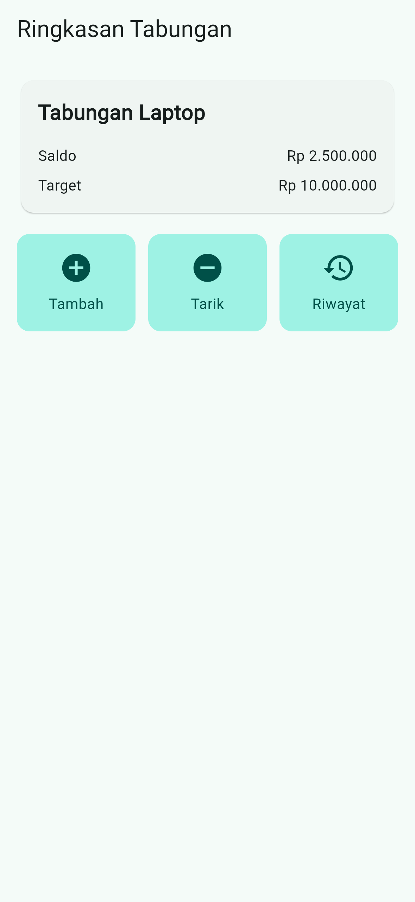
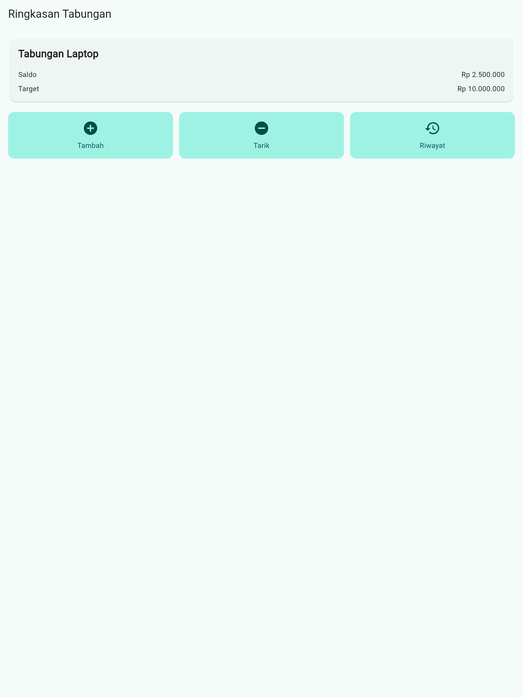

# Tabungku Layout – Ringkasan Tabungan

**Nama:** Azkiya Zahrul Umam
**NIM:** 20230801187

## Deskripsi

Aplikasi Flutter sederhana yang menampilkan layar "Ringkasan Tabungan":
satu kartu berisi nama tabungan, saldo, dan target (data statis), serta tiga
tombol ringkasan (Tambah, Tarik, Riwayat). Fokus pada penyusunan layout tanpa
form, state management, maupun database.

Widget yang digunakan: `MaterialApp`, `Scaffold`, `AppBar`, `Text`, `Icon`,
`Container`, `Padding`, `SizedBox`, `Column`, `Row`, `Card`, `Expanded`,
`SingleChildScrollView`.

## Cara Menjalankan

```bash
flutter pub get
flutter run
```

## Screenshot

Ponsel (portrait):



Tablet:


