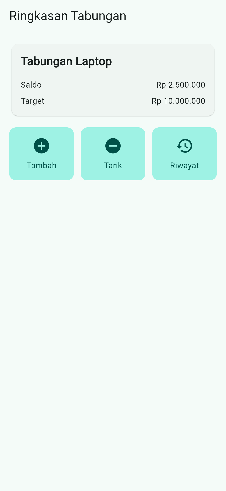
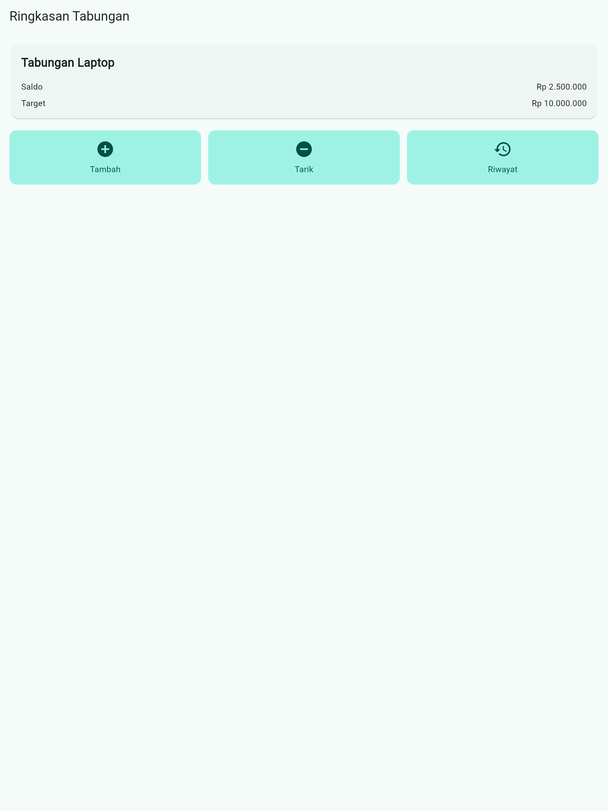

# Laporan Pengerjaan – Tabungku Layout (Ringkasan Tabungan)

| | |
|---|---|
| **Nama** | Azkiya Zahrul Umam |
| **NIM** | 20230801187 |
| **Proyek** | `tabungku_layout` |
| **Tanggal** | 2 November 2026 |

## 1. Tujuan

Menyusun layout layar "Ringkasan Tabungan" untuk aplikasi tabungan memakai
widget dasar Flutter saja. Belum ada form, state management, atau database;
data bersifat statis (hardcode).

## 2. Ketentuan

- Hanya widget dasar: `MaterialApp`, `Scaffold`, `AppBar`, `Text`, `Icon`,
  `Container`, `Padding`, `SizedBox`, `Column`, `Row`, `Card`, `Expanded`,
  `SingleChildScrollView`.
- Tidak memakai paket pihak ketiga; `dependencies` di `pubspec.yaml` tidak diubah.
- Tidak boleh overflow di ponsel (portrait) maupun tablet.
- `flutter analyze` harus bersih.

## 3. Struktur Layout

```
MaterialApp
└─ RingkasanPage (StatelessWidget)
   └─ Scaffold
      ├─ AppBar            -> "Ringkasan Tabungan"
      └─ body: SingleChildScrollView
         └─ Padding(16)
            └─ Column (crossAxisAlignment.start)
               ├─ Card
               │  └─ Padding(16)
               │     └─ Column (crossAxisAlignment.start)
               │        ├─ Text "Tabungan Laptop" (tebal)
               │        ├─ Row (spaceBetween): "Saldo"  | "Rp 2.500.000"
               │        └─ Row (spaceBetween): "Target" | "Rp 10.000.000"
               ├─ SizedBox(height: 16)
               └─ Row
                  ├─ Expanded -> _AksiItem (Tambah)
                  ├─ SizedBox(width: 12)
                  ├─ Expanded -> _AksiItem (Tarik)
                  ├─ SizedBox(width: 12)
                  └─ Expanded -> _AksiItem (Riwayat)
```

`_AksiItem` adalah widget kecil (`StatelessWidget`) berisi `Container`
(padding + warna + sudut membulat) dengan `Column` berisi `Icon` dan `Text`.
Dibuat satu kali dan dipakai tiga kali agar kode tidak berulang.

## 4. Pemenuhan Ketentuan

| Ketentuan | Cara pemenuhan |
|---|---|
| `MaterialApp` dengan `home: RingkasanPage` | `MyApp` mengembalikan `MaterialApp(home: const RingkasanPage())` |
| `AppBar` berjudul "Ringkasan Tabungan" | `Scaffold.appBar` |
| `SingleChildScrollView` + `Padding(16)` | Membungkus seluruh isi body |
| Label kiri, nilai kanan | `Row` dengan `MainAxisAlignment.spaceBetween` |
| Teks rata kiri di kartu | `Column` dengan `CrossAxisAlignment.start` |
| Tiga tombol lebar rata | `Row` berisi tiga `Expanded` |
| Tanpa overflow | Tanpa lebar tetap; `Expanded` + `SingleChildScrollView` |
| Komentar di tiap bagian layout | Komentar singkat di `lib/main.dart` |
| Tanpa paket pihak ketiga | `pubspec.yaml` tidak diubah |

Selain widget pada daftar, kode memakai `ThemeData`, `ColorScheme`,
`BoxDecoration`, `TextStyle`, dan `BorderRadius` hanya untuk warna, gaya teks,
dan sudut membulat. Semuanya bagian dari Flutter SDK, bukan paket tambahan.

## 5. Langkah Pengerjaan

1. Membuat proyek di `~/pemob/praktikum/` dengan
   `flutter create --platforms android,web tabungku_layout`.
2. Menghapus `test/widget_test.dart` bawaan karena merujuk ke aplikasi counter
   lama dan akan membuat `flutter analyze` gagal.
3. Menulis `lib/main.dart` sesuai struktur layout di atas.
4. Menjalankan `flutter analyze` -> **No issues found!**
5. Menjalankan `flutter build web` -> build berhasil.
6. Menjalankan aplikasi dengan `flutter run -d web-server --web-port 8080` dan
   membukanya di Chrome (`http://localhost:8080`).
7. Mengambil screenshot ponsel dan tablet lewat mode perangkat Chrome DevTools.

## 6. Hasil

### Ponsel (portrait)



Kartu dan tiga tombol memenuhi lebar layar. Tiga tombol sama lebar dan tidak
ada teks yang terpotong.

### Tablet



Pada layar lebar, kartu dan tiga tombol ikut melebar secara proporsional dan
tetap rata. Tidak ada overflow.

## 7. Verifikasi

| Pemeriksaan | Hasil |
|---|---|
| `flutter analyze` | Tidak ada masalah |
| `flutter build web` | Berhasil |
| Tampilan ponsel portrait | Tanpa overflow |
| Tampilan tablet | Tanpa overflow |

## 8. Catatan dan Keterbatasan

- Aplikasi diuji di **Chrome (Flutter web)** dengan mode perangkat DevTools,
  bukan di emulator Android. Emulator berjalan di Windows sehingga tidak
  terjangkau dari WSL tempat Flutter terpasang. Layout memakai widget yang sama
  di semua platform, tetapi uji di emulator Android belum dilakukan.
- Tombol Tambah, Tarik, dan Riwayat hanya tampilan (tanpa `onTap`), sesuai
  lingkup tugas yang hanya meminta layout.
- Data (nama tabungan, saldo, target) di-hardcode.
